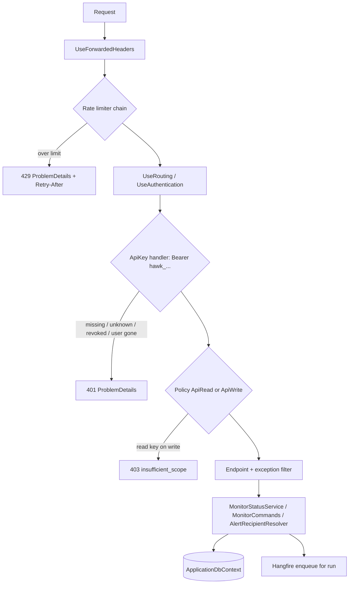
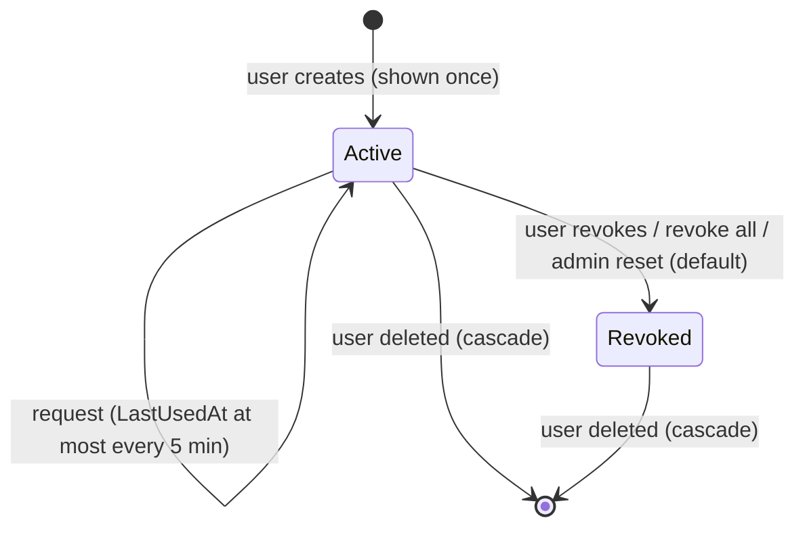

# Agent API (API keys and /api/v1) - Plan

## Goal Capsule

- **Objective:** An agent such as Claude Code, holding a key the user gave it, can see which Hawk monitors are failing and why, and can change who gets alerted and when, pause or resume monitors, and trigger checks. No browser and no scraped forms are involved.
- **Means:** a versioned JSON API under `/api/v1` that authenticates only with per-user API keys sent as `Authorization: Bearer` (KTD1, KTD2). The UI and the API call the same extracted services (KTD5).
- **Authority:** this plan's Requirements (R-IDs) win on behaviour. `AGENTS.md` rules win on conventions: provider-agnostic model, two migration sets, `ConcurrencyStamp` renewal, heartbeat invariants. KTDs win on mechanism.
- **Stop conditions:** stop and report if the API cannot be kept away from cookie auth, or if a write path would have to break a heartbeat invariant in `AGENTS.md`.
- **Execution profile:** this session implements and deploys 0.11.0 to prod1 (see Release). Before release, a separate reviewer on a more capable model and a second-model review check the completed work (Verification Contract).

---

## Product Contract

### Summary

Users create named API keys on a new **Account → API keys** page, either read-only or read-write. A key is shown once and can be revoked. With a key, an agent calls `/api/v1` to list monitors with a server-computed health, read a monitor's runs, alert state and effective alert recipients, change alert thresholds and alert emails, pause or resume a monitor, and queue a run. Every error is JSON.

### Problem Frame

Hawk is managed only through Razor Pages: cookie login, an antiforgery token on every POST, and HTML responses. An agent that wants to triage an outage or quiet a noisy monitor has to scrape forms, which breaks on any markup change and needs the user's password. The only machine endpoints are `/live`, `/ready` and `/ping/{token}`, and none of them can read or change monitors. Agents now run alongside the operator, and they need a supported path that holds less power than the user's login and can be revoked separately from it.

### Requirements

**API keys**

- R1. A signed-in user can create a key with a name and a scope, `read` or `write`. The plaintext key is shown exactly once, on the page that creates it.
- R2. A user can list their keys (name, scope, a non-secret prefix, created, last used) and revoke one or all of them. A revoked key is rejected on its next request.
- R4. A key acts as its user. It sees every monitor, as the UI does, and carries no admin powers.
- R5. Deleting a user removes their keys. A password reset revokes all of the user's keys, whether an admin does it or the user does it through Forgot password, because a reset is how an account is recovered after a compromise. A password change or a lockout leaves keys working.
- R6. A key never appears in the app log, the request log or the database in plaintext. It is accepted only in the `Authorization: Bearer` header. A key in the query string is ignored, so the request gets the normal 401.

**Reading**

- R7. `GET /api/v1` returns the caller (user, key name, scope) and lists the endpoints.
- R8. `GET /api/v1/monitors` lists all monitors in one call. Each entry has `state` (`active`, `paused`, `disabled`), `health` (`ok`, `failing`, `overdue`, `unknown`), whether the caller owns the monitor, and the failure summary when one applies: last completed run's time, HTTP status, error, consecutive failures and failing-since.
- R9. `GET /api/v1/monitors/{id}` adds the configuration the UI Details page shows, the alert state, and the effective alert recipients together with their source (`monitor`, `account`, `owner` or `admins`). It never returns the heartbeat ping token.
- R10. `GET /api/v1/monitors/{id}/runs` returns recent runs, newest first (default 25, max 100). `GET /api/v1/monitors/{id}/runs/{runId}` returns one run's diagnostics, and returns 404 when the run belongs to a different monitor.

**Changing (write scope only)**

- R11. `PATCH /api/v1/monitors/{id}/alerting` changes `alertAfterConsecutiveFailures` (1-20) and `alertEmailOverride`. An absent field stays unchanged. `null` or blank clears the email. A `null` threshold, an unknown field or an invalid value returns 400. `{}` changes nothing.
- R12. `GET` and `PUT /api/v1/account/alerting` read and replace the caller's account-wide alert email (`null` clears it). The response states that it applies only to monitors the caller owns.
- R13. `POST /api/v1/monitors/{id}/pause` and `.../resume` work on HTTP and heartbeat monitors. A monitor already in the target state returns 200 with `changed: false`. A disabled monitor returns 409 `monitor_disabled`.
- R14. `POST /api/v1/monitors/{id}/run` queues a run like the UI's **Run now** and returns 202 with a `runId` to poll. It runs paused monitors (the UI does too) and returns 409 for disabled monitors (`monitor_disabled`) and heartbeats (`heartbeat_not_runnable`). If a manual run started within the monitor timeout plus 60 seconds is still queued or running, it returns 202 with that run's id. An older unfinished run is treated as lost and a new run is queued.
- R15. Every API change is visible in the UI, and an open Edit form detects it as a concurrent change.

**Contract and protection**

- R16. Every `/api/*` response, errors included, is JSON. This covers unknown paths outside `/api/v1`, malformed request bodies and failures during authentication. Errors are `application/problem+json` with a stable `code`. A missing or bad key returns 401 and never redirects. A read key on a write endpoint returns 403 `insufficient_scope`. Exceptions never render the HTML error page.
- R17. API requests are rate-limited per client IP and per key and return 429 with `Retry-After` when over the limit.
- R19. A browser session cookie never authorizes an `/api` request.

### Acceptance Examples

- AE1. **Covers R11.** Given a monitor with override `ops@x.com`, `PATCH {"alertAfterConsecutiveFailures": 3}` keeps the override, `PATCH {"alertEmailOverride": null}` clears it, and `PATCH {"alertEmailOverrid": "a@b.c"}` (a typo) returns 400 and changes nothing.
- AE2. **Covers R13.** Pausing an active monitor returns `changed: true`, and pausing it again returns `changed: false`. Resuming a paused heartbeat sets its deadline to now + period + grace. Pausing a disabled monitor returns 409 `monitor_disabled`.
- AE3. **Covers R8.**
  - A monitor with only a queued run has `health: unknown`.
  - A heartbeat whose deadline has passed but whose miss the scheduler has not recorded yet has `health: overdue`.
  - An active HTTP monitor whose checks stopped running (scheduler or workers down) has `health: overdue` even though its last run was OK.
  - A paused monitor whose last run failed is `state: paused, health: failing`.
- AE4. **Covers R16, R19.** A request with a valid login cookie and no key returns 401 JSON without a `Location` header.

### Scope Boundaries

- Creating, editing (beyond alerting) or deleting monitors over the API.
- An MCP server, a Swagger UI, an OpenAPI document, admin endpoints and user management. Agents learn the API from `GET /api/v1` and `docs/agent-api.md`. An OpenAPI document can be added later without breaking clients.
- Exposing heartbeat ping tokens. A read key would hand out a credential that lets the holder fake heartbeats.

Considered and not built:

- **`If-Match`/ETag concurrency on PATCH.** Field-level PATCH means a lost update only affects the fields sent. The header can be added later without breaking clients. Revisit if agents and people edit the same alert settings at the same time.
- **A separate rate limit for run-now.** The per-key limit (R17) already bounds it, and a run already in flight is reused (R14).
- **Atomic in-flight check for run-now.** Two simultaneous calls can both queue a run. The cost is one extra check run, bounded by the per-key limit. Revisit if duplicate runs show up in practice.
- **A cap on active keys per user.** Only signed-in users create keys, rows are tiny, and limits apply per key and per IP. A cap can be added later without a data change.
- **A special error for keys sent in the query string, or Caddy redaction of query parameters.** Hawk ignores query keys, so the agent gets a 401 at once, and `docs/agent-api.md` says to use the header. Revisit if a leaked query key is ever found in a log.
- **Revoking keys on a password change.** A change needs the current password, so it is routine maintenance rather than recovery. A reset, which is the recovery path, revokes keys (R5).
- **An audit table of API changes.** Write endpoints log the user id, key id and action at Information level instead. Revisit if several people share an instance and need a change history.
- **Admin scope or role claims on keys.** No v1 endpoint needs them, and leaving roles off means a leaked admin key cannot do admin things.
- **Disabling keys on lockout.** Five wrong passwords to anyone's email would switch off that user's agents. Revoke or delete is the kill switch.
- **Checksummed key format (CRC suffix) for secret scanners.** Hawk is self-hosted, so no scanner partner would check it. The `hawk_` prefix is enough for grep-based scanning.

---

## Planning Contract

### Key Technical Decisions

- KTD1. **Key format and storage: `hawk_` plus 43 base64url characters (32 random bytes), stored as a SHA-256 hash with a unique index.** Lookup is by the hash of the presented key, so there is nothing to compare in constant time and nothing to parse. The UI shows a stored, non-secret `DisplayPrefix` (the first 12 characters). PBKDF2 or Argon2 add per-request CPU cost and no security for 256-bit random secrets. The `hawk_<id>_<secret>` alternative adds a parse step and only helps when looking up by id is cheaper than hashing, which is not the case here.
- KTD2. **A separate `ApiKey` authentication scheme that only `/api` policies name.** The handler is registered in its own `AddHawkApiAuthentication` extension, not in `IdentitySetup.AddHawkIdentity`, which the design-time factories share. The policies `ApiRead` and `ApiWrite` pin `AuthenticationSchemes = ["ApiKey"]` and require the `hawk:scope` claim, so the cookie is never evaluated for `/api` (R19). On each request the handler loads the key and its user. A missing user or a revoked key fails. Lockout is ignored (R5). The principal carries the user id, email, key id and scope, but no roles (R4). Challenge and forbid write ProblemDetails (R16). Minimal APIs have no antiforgery here, which the heartbeat endpoint already relies on.
- KTD3. **Rate limiting joins the chained global limiter in `AuthAbuseProtection`, which runs before authentication.** The chain gains two limiters, in the same shape as ping: one per IP for any `/api/*` request, then one per key for well-formed keys only. The key limiter partitions on the SHA-256 of the presented key, never the raw key. New `HawkSecurityOptions` fields are `ApiRequestsPerMinute` (default 120, range 1-6000, per key) and `ApiRequestsPerMinutePerIp` (default 600, range 1-60000). `OnRejected` returns ProblemDetails with `Retry-After` for `/api/`. The alternative, moving `UseRateLimiter` after authentication, would also reorder the login and ping limiters.
- KTD4. **JSON errors come from an `/api`-scoped middleware plus the endpoint mapping, both exposed as extension methods.**
  1. `UseHawkApiErrors()` is a `UseWhen` branch on `/api` placed after `UseExceptionHandler` and before routing. It catches any exception, including one thrown in the key handler (for example, the database is down), and writes 500 `internal_error`. It also turns empty-body status codes (400, 404, 405, 415) into ProblemDetails.
  2. The auth handler writes 401 and 403.
  3. `MapHawkApi()` maps an `/api/{**path}` fallback outside the `/api/v1` group that returns 404 `not_found`.
  4. `Program.cs` and `SecurityTestApplication` both call the two extensions, so the test host exercises the same paths.
- KTD10. **Write handlers read their JSON body themselves**, with `JsonDocument.ParseAsync` capped at 16 KB, instead of binding it as a parameter. Minimal-API binding rejects malformed JSON or a missing `Content-Type` before any filter runs, with an empty body. A wrong content type, an empty body or invalid JSON returns 400 `validation_failed`.
- KTD5. **Extract the UI's logic into services before writing the API, and switch the pages to them in the same unit.** That keeps both paths identical, most importantly heartbeat resume and set-based stamp renewal. The services:
  1. `MonitorStatusService`: health and failure summary for a set of monitors, with the "last completed run" query (moved from `Index.cshtml.cs` and `Index.cshtml`). It loads alert states in one query.
  2. `MonitorCommands`: pause, resume, queue-manual-run and update-alerting. Pause, resume and update-alerting are set-based and renew `ConcurrencyStamp`. Queue-manual-run leaves the stamp alone, as Run now does today.
  3. `AlertRecipientResolver`: moved out of `MonitorExecutor`, returning recipients and their source.
  4. The account alert email write, extracted from `Manage/Settings.cshtml.cs`.

  The Edit save is not reused: it resets `NextRunAt` and replaces headers and match rules.
- KTD6. **Merge-patch semantics for `PATCH .../alerting`.** The handler checks property presence on the parsed document (KTD10), because a plain nullable DTO cannot tell "absent" from `null`. Unknown properties return 400 (R11). Values go through the same checks `MonitorForm.Validate` applies: the 1-20 range, `EmailAddressAttribute`, max length 320 and no NUL characters. Those checks move into a small shared validator so the Edit form and the API cannot drift apart.
- KTD7. **Health is computed on the server from existing data.** It takes the first rule that applies:
  1. `overdue` applies only to an enabled, unpaused monitor. For a heartbeat, `NextRunAt` is in the past. For an HTTP monitor, `LastRunAt` is older than twice its interval plus its timeout plus one scheduler tick, so the agent can see that checks stopped running.
  2. `failing`: the last completed run failed.
  3. `ok`: the last completed run succeeded.
  4. `unknown`: no completed run exists.

  `state` is `disabled` when `Enabled` is false, otherwise `paused` when `IsPaused` is true, otherwise `active`. The UI's "Failing" group keeps its current rule, so the UI's behaviour does not change.
- KTD8. **The API uses `System.Text.Json` web defaults (camelCase), with enums as camelCase strings.** These are the same converter settings as `MonitorJsonPort`. Timestamps are UTC ISO 8601.
- KTD11. **Set-based key writes fall back to tracked updates on EF InMemory.** `TouchAsync` and revoke run on every authenticated request or on the keys page. InMemory, which `SecurityTestApplication` uses, cannot execute `ExecuteUpdateAsync`. Follow the `StatusCakeImporter` pattern, branching on `db.Database.IsRelational()`. `MonitorCommands` stays set-based only, and its HTTP tests run on the Postgres host.
- A bake-off was not warranted: every mechanism choice in this plan has a concrete, low-cost alternative that judgment settles.

### High-Level Technical Design

Request path for `/api/v1`:

API key lifecycle:

### Assumptions

- API traffic is light: a few agents polling every minute or so. The status list is two queries over all monitors and needs no paging (fewer than 100 monitors in production).
- On prod1, Caddy proxies `/api/*` without restriction and does not log the `Authorization` header: the infra `apps/hawk/site.caddy` has no `/api` matcher and `log_credentials` is not set. No infra change is needed beyond the release pin.

### System-Wide Impact

- **UI paths change underneath:** the monitors index (failing group, pause/resume/Run now), Details **Run now**, Manage → Settings (alert email) and `MonitorExecutor` (recipients) move onto the U1 services. Behaviour must stay identical, and U1's characterization tests guard it.
- **Auth boundary:** a second authentication scheme exists, used only by `/api` policies. The cookie remains the default scheme, so Razor Pages, the Hangfire dashboard and Identity are untouched.
- **Rate limiting:** the global limiter chain gains two limiters. Paths outside `/api` and `/ping` get no limiter, as today.
- **Data lifecycle:** a new table with a cascading foreign key to `AspNetUsers`, so user deletion removes keys with no change to the delete page. The admin and self-service password reset pages revoke the user's keys.
- **Concurrency:** API pause/resume/PATCH renew `ConcurrencyStamp`, so an Edit form that is open at the same time shows its existing conflict message (R15).

### Risks

- **U1 refactor regresses heartbeat resume or the failing group.** Mitigation: characterization tests first, then Postgres tests on the moved set-based code.
- **Alert email changes over the API silently redirect alerts.** Mitigation: detail responses show the effective recipients and source, writes are logged with the key id, and the account endpoint states its owned-monitors scope.
- **A leaked write key can pause every monitor.** Accepted for v1: keys are revocable at once, rate-limited, never carry admin rights, and read-only keys exist for agents that only watch.

### Sources

- `Hawk.Web/Infrastructure/HeartbeatEndpoints.cs` (minimal-API pattern, `Cache-Control: no-store`, no secret logging).
- `Hawk.Web/Infrastructure/AuthAbuseProtection.cs` (chained limiters, `ReadBounded`, `OnRejected`).
- `Hawk.Web/Infrastructure/AuthCookieSetup.cs` (cookie redirect that `/api` must avoid).
- `Hawk.Web/Pages/Monitors/Index.cshtml.cs` (pause, `ResumeAsync` heartbeat grouping, failing query), `Details.cshtml.cs` (`OnPostRunNowAsync`), `Edit.cshtml.cs` (why its save is not reused).
- `Hawk.Web/Services/Monitoring/MonitorExecutor.cs` (recipient resolution, manual runs on paused monitors).
- `Hawk.Tests/SecurityTestApplication.cs` (own pipeline: API wiring must be extension methods), `PostgresIntegrationTests.cs` (where `ExecuteUpdate` paths are tested).
- ASP.NET Core 10: API endpoints return 401/403 instead of cookie redirects.
- `Hawk.Web/Services/Import/StatusCakeImporter.cs` (`IsRelational()` fallback for InMemory).

---

## Implementation Units

### U1. Extract shared monitor services

- **Goal:** pause, resume, run now, alert-settings writes, health and recipient resolution exist once, as services the pages already use.
- **Requirements:** R8, R9, R13, R14, R15 (KTD5, KTD7).
- **Dependencies:** none.
- **Files:**
  - Create `Hawk.Web/Services/Monitoring/MonitorStatusService.cs`, `MonitorCommands.cs`, `AlertRecipientResolver.cs`, `AlertSettingsValidator.cs`, `AccountAlertSettings.cs`.
  - Modify `Hawk.Web/Pages/Monitors/Index.cshtml.cs`, `Index.cshtml`, `Details.cshtml.cs`, `MonitorForm.cs`, `Hawk.Web/Services/Monitoring/MonitorExecutor.cs`, `Hawk.Web/Areas/Identity/Pages/Account/Manage/Settings.cshtml.cs`, `Hawk.Web/Program.cs` (DI).
  - Tests: `Hawk.Tests/MonitorStatusTests.cs`, additions to `Hawk.Tests/PostgresIntegrationTests.cs`.
- **Approach:**
  1. `MonitorCommands.PauseAsync/ResumeAsync` take a monitor query and return the changed count. Resume keeps the heartbeat-first grouped update from `Index.ResumeAsync`. Single-monitor calls report `changed` and `disabled` outcomes for R13.
  2. `QueueManualRunAsync(id, reuseInFlight)` returns `Queued(runId) | AlreadyInFlight(runId) | NotFound | Heartbeat | Disabled`. The API passes `reuseInFlight: true` and rejects `Disabled` (R14). The Details page passes `false` and still queues disabled monitors, so it behaves exactly as today.
  3. `UpdateAlertingAsync(id, threshold?, email?, clearEmail)` is one `ExecuteUpdateAsync` that renews the stamp.
  4. `AlertRecipientResolver` keeps the executor's resolution order and adds a source value. The executor calls it.
  5. The index and its view use `MonitorStatusService` for the failing group, with the same predicate as today.
  6. `AlertSettingsValidator` holds the threshold range, email format, length and NUL checks. `MonitorForm.Validate` calls it for those fields, and the API calls it too (KTD6).
  7. `AccountAlertSettings.SetEmailAsync(userId, email?)` takes over the upsert or delete of `UserAlertSettings` from `Manage/Settings.cshtml.cs`. The Settings page and R12 both call it.
- **Execution note:** characterize the current index failing-group and resume behaviour in tests before moving the code.
- **Patterns to follow:** set-based updates in `Index.cshtml.cs`, heartbeat deadlines via `HeartbeatTokens.InitialDeadline`.
- **Test scenarios:**
  - Health of a monitor with no runs, only a queued run, a last failed completed run, a last OK run, and an overdue heartbeat: `unknown`, `unknown`, `failing`, `ok`, `overdue` (Covers AE3).
  - An active HTTP monitor with a last OK run and `LastRunAt` older than 2×interval + timeout + tick is `overdue`. The same monitor paused is `paused, ok`.
  - An overdue heartbeat whose last completed run failed is `overdue`, because the precedence rule puts it first.
  - Paused + last run failed gives `state: paused, health: failing`. Disabled and paused gives `state: disabled`.
  - Postgres: pausing an active monitor renews the stamp and returns changed; pausing again returns unchanged and keeps the stamp.
  - Postgres: resuming a paused heartbeat sets `NextRunAt` to now + period + grace in the same statement (Covers AE2).
  - Postgres: pause or resume on a disabled monitor changes nothing and reports disabled.
  - Postgres: queue manual run creates a `queued` run and one Hangfire job and leaves the stamp unchanged. With reuse, a second call while queued returns the same run id, and a `queued` run older than timeout + 60 s gets a new run. Without reuse (Details), a second call creates a second run. A heartbeat returns `Heartbeat`.
  - Settings page: saving and clearing the account alert email through `AccountAlertSettings` behaves as before.
  - Validator: thresholds 0 and 21, an invalid email, a 321-character email and an email containing `\0` are rejected through both the Edit form and the validator directly.
  - Postgres: `UpdateAlertingAsync` with only a threshold leaves the email, with clear removes it, and both renew the stamp. An Edit save with the old stamp then raises the concurrency flash (Covers R15).
  - Recipient resolver: monitor override → `monitor`, owner's account setting → `account`, neither → `owner`, owner without email → `admins`.
  - The existing index, details, settings and executor tests still pass unchanged.
- **Verification:** all existing tests pass, the new service tests pass, and the UI behaves the same.

### U2. API key data model and key service

- **Goal:** keys can be issued, validated, listed and revoked, and stored only as hashes.
- **Requirements:** R1, R2, R5, R6 (KTD1, KTD11).
- **Dependencies:** none.
- **Files:**
  - Create `Hawk.Web/Data/ApiKeys/ApiKey.cs` and `Hawk.Web/Services/ApiKeys/ApiKeyService.cs`.
  - Modify `Hawk.Web/Data/ApplicationDbContext.cs`, `Hawk.Web/Pages/Admin/Users/ResetPassword.cshtml.cs`, `Hawk.Web/Areas/Identity/Pages/Account/ResetPassword.cshtml.cs`.
  - Add migrations in `Hawk.Web/Data/Migrations/` and `Hawk.Web/Data/Migrations/Postgres/` (`AddApiKeys`).
  - Tests: `Hawk.Tests/ApiKeyServiceTests.cs`, additions to `PostgresIntegrationTests.cs`.
- **Approach:**
  1. The entity has `Id` (Guid), `UserId` (450), `Name` (100), `Scope` (enum stored as a string, max 16), `DisplayPrefix` (16), `SecretHash` (64-char hex, unique index), `CreatedAt`, `LastUsedAt?`, `RevokedAt?`.
  2. A foreign key to `IdentityUser` with cascade delete covers R5. It is configured in `OnModelCreating` with `HasOne<IdentityUser>()`, which is provider-agnostic.
  3. `ValidateAsync(presented)` returns key and user, or null.
  4. `TouchAsync` writes `LastUsedAt` with a conditional `ExecuteUpdateAsync`, only when the stored value is older than 5 minutes. On InMemory it falls back to a tracked update (KTD11), and so does `RevokeAllAsync`.
  5. After a successful reset, both reset pages (admin and Forgot password) call `RevokeAllAsync` for that user (R5).
- **Patterns to follow:** `Data/Alerting/UserAlertSettings.cs`, `HeartbeatTokens.Generate` (randomness), the two-provider migration commands in `AGENTS.md`.
- **Test scenarios:**
  - Generated key matches `^hawk_[A-Za-z0-9_-]{43}$`, and its stored hash is the SHA-256 of the key, not the key.
  - Validate accepts the issued key and rejects a revoked key, an unknown key, a key with one character changed, and a key without the prefix.
  - Revoke all marks every active key of that user and none of another user's.
  - Postgres: deleting the user removes their keys, `TouchAsync` writes once within 5 minutes, and the unique index rejects a duplicate hash.
  - An admin password reset revokes the user's keys. A Forgot-password reset with a valid token revokes them. A failed reset (bad token) revokes nothing.
  - `DatabaseSetupTests.Migrations_are_up_to_date_with_the_model` passes for both providers.
- **Verification:** migrations apply on both providers, and the key service tests pass.

### U3. API key authentication, policies and rate limits

- **Goal:** `/api` requests authenticate by key alone and are rate-limited.
- **Requirements:** R4, R5, R6, R16, R17, R19 (KTD2, KTD3, KTD4).
- **Dependencies:** U2.
- **Files:**
  - Create `Hawk.Web/Infrastructure/ApiKeyAuthentication.cs` (handler, `AddHawkApiAuthentication`, policies) and `Hawk.Web/Infrastructure/ApiErrors.cs` (`UseHawkApiErrors`, problem writer, KTD4).
  - Modify `Hawk.Web/Infrastructure/AuthAbuseProtection.cs`, `Hawk.Web/Program.cs`, `Hawk.Tests/SecurityTestApplication.cs`.
  - Tests: `Hawk.Tests/ApiAuthHttpTests.cs`, additions to `Hawk.Tests/AuthAbuseProtectionTests.cs`.
- **Approach:**
  1. The handler reads only `Authorization: Bearer` (R6).
  2. It calls `TouchAsync` after a successful authentication.
  3. Log only the key id, never the key or its hash. Add the new limits and their validation bounds.
  4. Add `UseHawkApiErrors()` in both pipelines, after `UseExceptionHandler` and before routing.
- **Patterns to follow:** the ping limiter pair in `AuthAbuseProtection`, `HawkSecurityOptions.ReadBounded`.
- **Test scenarios:**
  - No header, a malformed header, an unknown key and a revoked key each return 401 problem+json with no `Location` header.
  - A login cookie without a key returns 401 (Covers AE4).
  - A read key on a write endpoint returns 403 `insufficient_scope`, and a write key passes both policies.
  - A key whose user was deleted returns 401. A locked-out user's key still works.
  - The authenticated principal has no role claims, even for an Admin user.
  - Over the per-key limit returns 429 with `Retry-After` while another key from the same IP still passes. Over the per-IP limit, random keys get 429.
  - Out-of-range values for the new settings fail startup (`Security_settings_reject_out_of_bounds_values` rows).
  - A valid key in the query string with no header returns 401, and the response does not echo the key.
  - A key lookup that throws (simulated database failure) returns 500 problem+json, not the HTML error page.
- **Verification:** auth and limiter tests pass, and existing login/ping limiter tests are unchanged.

### U4. Account → API keys page

- **Goal:** users manage their keys in the UI.
- **Requirements:** R1, R2.
- **Dependencies:** U2.
- **Files:**
  - Create `Hawk.Web/Areas/Identity/Pages/Account/Manage/ApiKeys.cshtml(.cs)`.
  - Modify `_ManageNav.cshtml` and `Hawk.Web/Pages/Shared/_LoginPartial.cshtml`.
  - Tests: `Hawk.Tests/ApiKeysPageHttpTests.cs`.
- **Approach:**
  1. The create form has a required Name (max 100) and a Scope radio group that defaults to **Read**. Each option has one line of help: Read is "list monitors and read runs and alert state". Write is "also pause and resume, run checks and change alert settings".
  2. Create renders the new key on the POST response itself (`Page()`, not TempData) in a "Copy this key now, it will not be shown again" panel. The panel has a read-only, selectable field, a copy button, a short curl example against `/api/v1`, and `Cache-Control: no-store`. The form is not refilled. A browser resubmit of that POST creates a second key; this is an accepted trade-off, and the user can revoke the extra one.
  3. The list shows active keys only: name, scope, prefix, created and last used (browser-local time via `<time data-utc>`, "Never" when unused). Each row has a revoke button. A user with no keys sees "No API keys yet".
  4. Single revoke and **Revoke all** both ask for confirmation, naming the key or the count. Revoke all is hidden when no keys exist.
- **Patterns to follow:** `Manage/Settings.cshtml(.cs)` styling and PRG flash messages, `hawk-btn` classes.
- **Test scenarios:**
  - Creating a key shows it once. Reloading the list does not show it again, and the HTML of the list never contains the plaintext.
  - Revoke via the page makes that key's next API call return 401.
  - Creating with an empty name or an invalid scope shows a validation error. A create POST without a scope creates a read key.
  - Another user's key id posted to revoke changes nothing (404 or no-op).
- **Verification:** page tests pass, and the page renders in light and dark mode.

### U5. `/api/v1` endpoints

- **Goal:** the endpoints in R7-R14 work, with JSON errors.
- **Requirements:** R7-R16 (KTD4, KTD6, KTD7, KTD8, KTD10).
- **Dependencies:** U1, U3.
- **Files:**
  - Create `Hawk.Web/Infrastructure/ApiEndpoints.cs` (`MapHawkApi`, group, filter, fallback) and `Hawk.Web/Infrastructure/ApiModels.cs` (response records).
  - Modify `Hawk.Web/Program.cs`, `Hawk.Tests/SecurityTestApplication.cs`.
  - Tests: `Hawk.Tests/ApiHttpTests.cs`, API cases in `Hawk.Tests/PostgresIntegrationTests.cs`.
- **Approach:**
  1. Handlers are thin and call the U1 services.
  2. `ApiWrite` is required on PATCH, PUT and POST, and `ApiRead` on GET.
  3. Write handlers log `user id, key id, monitor id, action` at Information.
  4. Responses set `Cache-Control: no-store`.
  5. Error codes: `unauthorized`, `insufficient_scope`, `not_found`, `validation_failed` (with field errors), `monitor_disabled`, `heartbeat_not_runnable`, `rate_limited`, `internal_error`.
  6. Map the `/api/{**path}` fallback outside the `/api/v1` group (KTD4).
  7. Tests that reach `MonitorCommands` (pause, resume, PATCH, run) run over HTTP on the Postgres host. The InMemory `SecurityTestApplication` covers auth, scope, errors and reads (KTD11).
  8. The run response includes the run URL to poll and advises stopping after the monitor timeout plus 60 seconds.
- **Patterns to follow:** `HeartbeatEndpoints` static handler style, `MonitorJsonPort` serializer options.
- **Test scenarios:**
  - `GET /api/v1` returns the caller's email, key name and scope.
  - The list returns every monitor with `state`, `health`, `ownedByCaller` and the failure summary for a failing one.
  - Detail returns alert state and recipients with source, omits the heartbeat token, and returns 404 problem+json for an unknown id.
  - Runs: default limit 25, `limit=500` is capped at 100, a run from another monitor returns 404.
  - PATCH cases from AE1, plus threshold 0 and 21 → 400, an invalid email → 400, a body that is not an object → 400.
  - PATCH and PUT with malformed JSON, an empty body or `Content-Type: text/plain` → 400 problem+json `validation_failed`. A body over 16 KB → 400.
  - PUT account alerting sets and clears the caller's setting and returns the owned-monitors note.
  - Pause and resume cases from AE2, through HTTP on Postgres.
  - Run: an HTTP monitor → 202 with run id and one job, a second call → the same run id, a heartbeat → 409 `heartbeat_not_runnable`, a disabled monitor → 409 `monitor_disabled`, a paused monitor → 202.
  - An exception in a handler returns 500 problem+json, not HTML. Unknown `/api/v1/nope` and `/api/v2/x` return 404 problem+json. `limit=abc` returns 400 problem+json.
- **Verification:** the HTTP and Postgres API tests pass on both test hosts.

### U7. E2E, documentation and version

- **Goal:** the full flow is proven in the browser stacks and documented.
- **Requirements:** all.
- **Dependencies:** U4, U5.
- **Files:**
  - Create `e2e/tests/api.spec.ts`.
  - Modify `AGENTS.md` (an "Agent API" section, the cheatsheet entries for the new limits, the version and the date), `CHANGELOG.md`, `Hawk.Web/Hawk.Web.csproj` and `Hawk.Tests/Hawk.Tests.csproj` (0.11.0).
  - Create `docs/agent-api.md`, the endpoint reference for agents. It covers:
    - auth (header only, never the query string)
    - every endpoint with its request and response fields
    - error codes and health precedence
    - polling advice
    - the owned-monitors note on account alerting
- **Approach:** the spec creates a key on the page, lists monitors with it, pauses and resumes a seed monitor, queues a run and polls it to completion, PATCHes alerting, then revokes the key and expects 401.
- **Test scenarios:**
  - The spec passes on the SQL Server and PostgreSQL e2e stacks.
  - Screenshots of the API keys page are captured with `snap()`.
- **Verification:** both e2e stacks are green, and the docs match the shipped endpoints.

---

## Verification Contract

| Gate | Command | When |
|---|---|---|
| Unit + Postgres integration | `HAWK_REQUIRE_POSTGRES_TESTS=1 dotnet test Hawk.sln -v:m` | after every unit |
| Migrations current | `DatabaseSetupTests` (in the run above) | U2 |
| E2E SQL Server | `npm --prefix e2e test` | U7, before release |
| E2E PostgreSQL | `docker compose -f docker-compose.e2e.postgres.yml ...` (command in `AGENTS.md`) | U7, before release |
| Implementation review | an independent review by a more capable model, plus a second-model review | before release |

## Definition of Done

- Every R has a passing test that names it, and AE1-AE4 are covered.
- Existing tests pass unchanged except where U1 moved the code they reach.
- No plaintext key in logs, the database or list HTML. A grep of the test logs for `hawk_` finds only the display prefixes.
- `AGENTS.md`, `CHANGELOG.md`, `docs/agent-api.md` and the version are updated to 0.11.0.
- No dead code from abandoned attempts remains in the diff.

---

## Release

1. Commit the units, then push `main` to GitHub.
2. Build the image from `git archive HEAD` and push it only to `registry.dualconsult.net/dualconsult/hawk` (never `:latest` to GHCR).
3. Take a `pg_dump` of the prod1 Hawk database, the PostgreSQL counterpart of the `AGENTS.md` backup rule, and record where it is stored.
4. Pin the digest in the infra repo's `apps/hawk/release.env`, then commit and push only that file. The infra working tree holds unrelated changes from other sessions; leave them alone.
5. Deploy with `scripts/deploy-app.sh hawk app edge`.
6. Live checks:
   - The `AddApiKeys` migration is applied.
   - The container runs 0.11.0 with no restarts.
   - `/api/v1` without a key and `/api/nope` both return problem+json (401 and 404).
   - A test key created in the UI lists monitors and then is revoked.
   - Neither the app log nor the Caddy access log contains the key.
7. Rollback: restore the 0.10.0 pin (`sha256:e111226e121f82ad7953d6f7a24ba8f08e706ca3aa2dfb42386ef12a5c584c5c`) and redeploy. The migration only adds a table, so 0.10.0 still runs against the migrated schema. Restore the `pg_dump` only if data is damaged.
8. Record the deployment in this plan's Release section.
